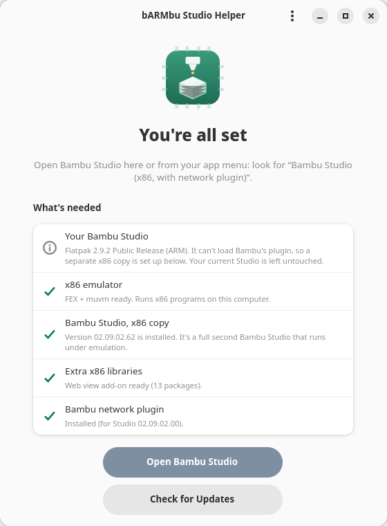
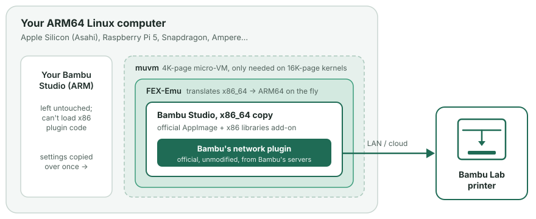

<p align="center">
  
</p>

<h1 align="center">B<b><i>ARM</i></b>bu Studio Helper</h1>

<p align="center">
  <b>Use your Bambu Lab printer from an ARM64 Linux computer.</b><br>
  Apple Silicon with Asahi Linux, Raspberry Pi 5, Snapdragon and other ARM boards.
</p>

<p align="center">
  <a href="https://github.com/amruthwo/barmbu/actions/workflows/ci.yml"></a>
  <a href="https://github.com/amruthwo/barmbu/releases/latest"></a>
  <a href="LICENSE"></a>
</p>

<p align="center">
  <picture>
    <source media="(prefers-color-scheme: dark)" srcset="docs/images/app-dark.png">
    
  </picture>
</p>

> Unofficial community tool. Not affiliated with or endorsed by Bambu Lab.
> It downloads Bambu's own software from Bambu's servers at set-up time; no
> Bambu files are included in this repository.

Bambu Studio's printer features (sending prints, the camera, the device
tab) live in a closed-source network plugin that Bambu only builds for x86
PCs. BARMbu Studio Helper runs Bambu's real plugin on ARM. Open the app,
press **Set Up**, then open Bambu Studio from your app menu.

---

## Why a second Bambu Studio?

Bambu Studio talks to your printer through a closed-source **network plugin**
(`libbambu_networking.so` and a few companion files). Bambu Lab only builds
it for regular **x86_64** PCs, and an ARM program can't load x86 code. Your
Flatpak Bambu Studio on ARM is an ARM program, so the plugin can never load
inside it, and x86 machine code can't be "patched" into ARM code.

So on ARM the app sets up a **separate x86_64 copy of Bambu Studio** that runs
under emulation, with the real plugin inside it:

<p align="center">
  
</p>

| Piece | What it is | Size |
|---|---|---|
| FEX-Emu (+ muvm) | The x86 emulator. On 16K-page kernels (Apple Silicon) FEX runs inside muvm, a tiny 4K-page virtual machine. | from your distro, set up by the app |
| Bambu Studio, x86 copy | Bambu Lab's official Linux AppImage, unpacked. A full second Studio. | ~180 MB download |
| Extra x86 libraries | WebKitGTK and friends, from **Fedora's or Ubuntu's own x86_64 packages** (matching the emulator's root filesystem), checksum-verified. | ~90 MB |
| Network plugin | Downloaded from Bambu Lab's server, the same file Studio fetches. | ~25 MB |

Your existing Bambu Studio is not changed. The first time, your printers,
filaments and settings are copied over from the Flatpak copy.

The plugin is Bambu's own, unmodified, and signs in with its own built-in
credentials. Nothing is cracked, re-signed or faked.

On a normal x86_64 PC the app just drops the plugin into your Bambu Studio.

---

## Install

Download one package from the [Releases page](https://github.com/amruthwo/barmbu/releases/latest)
(or build them yourself with `make`, see below):

```bash
sudo dnf install ./barmbu-*.noarch.rpm        # Fedora / Asahi
sudo apt install ./barmbu_*_all.deb            # Debian / Ubuntu
flatpak install --user barmbu-*.flatpak        # any distro (aarch64)
```

Then open **BARMbu Studio Helper** from your app menu.

If the emulator isn't installed yet, the app shows an **Install** button
(it asks for your password). See [Supported systems](#supported-systems) for
what that does on your distro.

---

## Supported systems

| System | Emulator setup | Status |
|---|---|---|
| **Fedora Asahi Remix** (Apple Silicon) | `dnf`: FEX, muvm, Fedora x86 root filesystem | ✅ tested (M1 MacBook Air) |
| **Fedora** on other ARM64 | same as above | should work, untested |
| **Ubuntu** 22.04+ | FEX's official PPA, CPU-matched build, Ubuntu 24.04 root filesystem | should work, untested |
| **Raspberry Pi OS / Debian** 13+ | FEX's Ubuntu 24.04 build plus the 4K kernel switch on a Pi 5 | 🧪 experimental |
| Arch, openSUSE, others | the app tells you what to install | manual |

**16K vs 4K memory pages.** FEX needs a kernel with 4K memory pages. Some
ARM kernels use 16K pages: Apple Silicon (Asahi) and the Raspberry Pi 5's
default kernel.

* **Apple Silicon:** the app uses **muvm**, a tiny 4K-page virtual machine
  that Asahi ships. Nothing to do.
* **Raspberry Pi 5:** Raspberry Pi OS already includes a 4K-page kernel. The
  app shows a **Switch** button (or run `barmbu pi-4k-kernel`), which adds
  `kernel=kernel8.img` to `/boot/firmware/config.txt` and keeps a backup.
  Restart, and you're set. `barmbu pi-4k-kernel --undo` switches back.

  What this changes: the Pi boots Raspberry Pi's own generic 64-bit kernel
  (the one Pi 3 and 4 use, which supports the Pi 5) instead of the Pi 5
  tuned one. Raspberry Pi OS installs and updates both, with their modules,
  so nothing is downloaded or replaced. Expect a few percent less speed in
  some memory-heavy work. Programs that dislike 16K pages tend to work
  better, not worse. If `config.txt` already picks a kernel, the app leaves
  it alone. If the Pi ever doesn't boot, put the SD card in another computer
  and delete the `kernel=kernel8.img` line from `config.txt`, or copy
  `config.txt.barmbu-backup` over it.
* **Other 16K kernels:** install muvm if your distro has it, or boot a 4K
  kernel.

Reports from other machines are very welcome: please
[open an issue](https://github.com/amruthwo/barmbu/issues) with the output of
`barmbu detect`.

---

## Using the app

1. Press **Set Up**. It downloads Bambu Studio and the plugin, adds the
   libraries, and creates the menu entry. Open **Details** to watch each step.
2. Press **Open Bambu Studio**, or pick **"Bambu Studio (x86, with network
   plugin)"** from your app menu. The first start under emulation takes a
   minute.
3. Later, **Check for Updates** fetches a newer Bambu Studio and matching
   plugin when Bambu releases one.
4. The ⋮ menu has **Remove Everything…** (your settings are kept).

---

## Command line

The window is a front-end for the `barmbu` command, which does
the same things:

```bash
barmbu detect                     # what's on this computer
barmbu setup-emulator             # install FEX (+ muvm) and an x86 root filesystem
barmbu pi-4k-kernel [--undo]      # Raspberry Pi 5: use the 4K-page kernel
barmbu install --download-studio  # set everything up
barmbu install --update           # newest Studio + plugin
barmbu launch                     # start the x86 Studio
barmbu status --json              # machine-readable status
barmbu uninstall [--all]          # remove (--all: also the x86 Studio)
barmbu check-update               # newer version of this tool on GitHub?
barmbu self-update                # download + install it (right package type)
```

Options for `install`: `--appimage FILE` (use an AppImage you already have),
`--local-dir DIR` (use plugin `.so` files you already have), `--offline`,
`--region US|CN`, `--rebuild-libs`.

Where things go:

* `~/.local/share/barmbu/`: the x86 Studio, the library add-on
  image and the launcher
* `~/.config/BambuStudio/`: the x86 Studio's settings, with the plugin in
  `plugins/`
* `~/.cache/barmbu/`: temporary downloads, cleared after a
  successful set-up

Disk space: about 620 MB after set-up (unpacked Studio ~520 MB, library
add-on ~90 MB, plugin ~60 MB). The downloaded AppImage is deleted once unpacked.

---

## Building the packages

```bash
make            # checks, then .deb, source tarball and .rpm
make test       # checks + unit tests
make flatpak    # Flatpak bundle (needs flatpak-builder; uses GNOME 51 runtime)
```

The `.rpm` uses `rpmbuild` if installed. If it isn't, it builds in a
throwaway Fedora container through rootless `podman`, so nothing extra is
installed on your machine. All packages land in `dist/`.

### Releasing

CI (`.github/workflows/ci.yml`) runs the tests on every push. To publish a
release, bump `__version__` in `src/barmbu.py` (and the
`<releases>` entry in the metainfo), then:

```bash
git tag v0.2.0 && git push origin v0.2.0
```

CI builds the .deb, .rpm, tarball and aarch64 Flatpak and attaches them to a
GitHub Release. The app checks that latest release on start-up. It detects
whether it was installed as an rpm, deb or Flatpak, downloads the matching
file, verifies its SHA-256 against GitHub's published digest, and installs it
(rpm/deb ask for your password). Source installs get a link instead.
Set `BARMBU_NO_UPDATE_CHECK=1` to turn the check off.

Source layout: `src/barmbu.py` (the tool), `src/emulator_setup.py`
(installing FEX per distro), `src/x86_overlay.py` (library add-on from Fedora
RPMs, via dnf), `src/deb_addon.py` (library add-on from Ubuntu .debs, pure
Python), `src/barmbu_gui.py` (the window), `data/`
(menu entry, icon, app-store description), `packaging/` (deb/rpm/flatpak),
`tests/`.

---

## What's been checked, and what hasn't

Checked on an M1 MacBook Air running Fedora Asahi 45:

* the x86 Studio (02.09.02.62) starts under muvm + FEX with the library
  add-on, and all 165 of its libraries resolve;
* Bambu's server hands out the plugin without a login, and with the plugin
  in place Studio starts the plugin's own network log and certificate store.

Heads-Up: On my P1S, video playback was never really smooth, and under emulation
the playback is less than perfect.  I would say it's functional, but momentary
video cutouts and low frame rates are typical. On my machine, the 3D view is 
pretty smooth under emulation, but slicing seems to take slightly longer.  I 
can confirm that I'm able to connect to and printing on my printer. For monitoring
prints in progress, I use the Bambu Handy app on my phone for a better experience.

If the 3D view misbehaves on your machine, that's the emulator's graphics path, 
not the plugin.

The library add-on is built from Fedora packages (with `dnf`) when the
emulator uses Fedora's root filesystem, and from Ubuntu packages (pure Python,
any distro) when it uses Ubuntu's. Ubuntu's archive and package download path
is tested; the full Ubuntu and Raspberry Pi set-ups are not yet.

---

## Uninstall

In the app: ⋮ → **Remove Everything…**. Or `barmbu uninstall --all`.
Your Bambu Studio settings in `~/.config/BambuStudio` are left alone.
